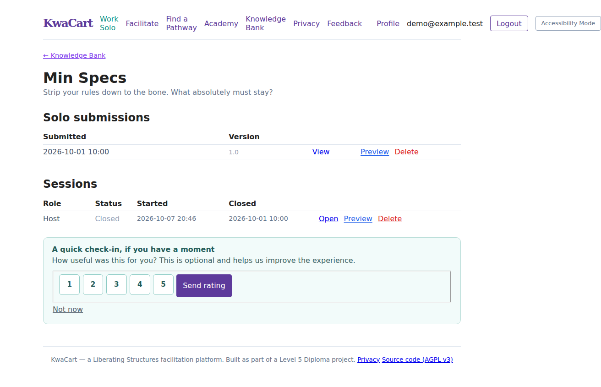
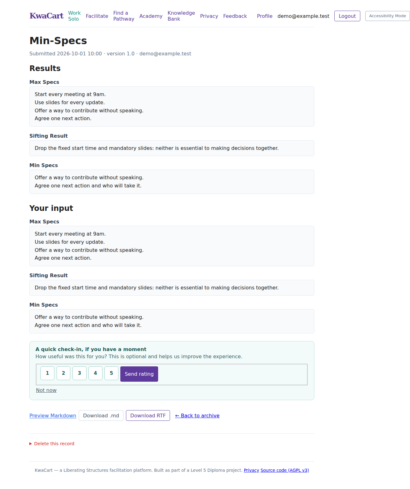
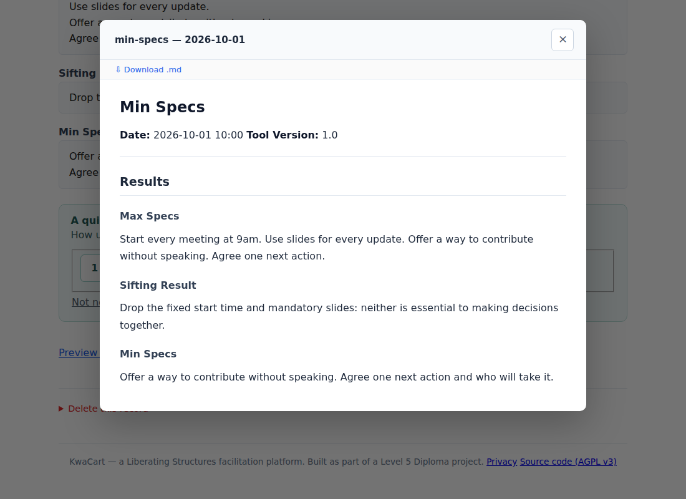

# Run KwaCart yourself

KwaCart is free self-hosted facilitation software. It includes all tools, live
sessions, the Academy, archives and exports. There is no subscription,
checkout or payment requirement.

**[Download the latest KwaCart ZIP](https://github.com/QualityLemons/kwacart-selfhost/archive/refs/heads/main.zip)**
· [View the source on GitHub](https://github.com/QualityLemons/kwacart-selfhost)

KwaCart runs on your own computer and opens in your normal web browser.
The ZIP above is source software with a launcher, not a standalone desktop installer.
You do not need a GitHub, Replit, Stripe, Cloudinary or cloud database account.

**Without installing Python:** use a standalone package from
**[KwaCart desktop releases](https://github.com/QualityLemons/kwacart-selfhost/releases)**.
See **[download and first-account instructions](DESKTOP_RELEASES.md)** for
Windows, Intel/Apple silicon Mac and Linux. Desktop previews are unsigned;
choose a tested package asset, not the “Source code” ZIP. The source instructions
below remain available for advanced users and shared servers.

KwaCart's software is licensed under GNU Affero General Public License v3.0
(`AGPL-3.0-only`); see `LICENSE` and `NOTICE`. Third-party libraries and
attributed content retain their respective rights and licences. The software is
provided without warranty.

## Local use: from ZIP to browser

**First time:** install Python once → download and extract the ZIP → start
KwaCart → create a login → use the toolkit in your browser.

### 1. Install Python once

Install **Python 3.13 (recommended)** from [python.org](https://www.python.org/downloads/).
Python 3.12 and 3.14 are also supported by this launcher. Do not assume a newer,
untested Python release will work with the included package versions.

- **Windows:** run the Python installer. Select **Add python.exe to PATH** if
  that option appears. Finish installing before starting KwaCart.
- **Mac:** open the downloaded Python installer and follow its instructions.
  The older Python supplied by your operating system may not be suitable.
- **Linux:** install a supported Python version and its `venv` support using
  your distribution's package manager.

You do not need to install Playwright's browser or set up a cloud service.
The first KwaCart launch needs internet to download its Python packages;
later launches reuse the installed packages unless the requirements change.

### 2. Download the ZIP

Click **[Download the latest KwaCart ZIP](https://github.com/QualityLemons/kwacart-selfhost/archive/refs/heads/main.zip)**.
Your browser normally saves it in **Downloads**. If you prefer to use the
GitHub repository page, choose the green **Code** button, then **Download ZIP**.

### 3. Extract it — do not run it inside the ZIP

- **Windows:** right-click the downloaded ZIP → **Extract All…** → **Extract**.
- **Mac:** double-click the ZIP to create an ordinary folder.
- **Linux:** use your file manager's **Extract** option.

Move the extracted folder somewhere you will keep it, such as **Documents**.
Open it. If you see another folder inside, open that too: the right folder
contains **`Start KwaCart.bat`**, **`Start KwaCart.command`**, **`start_kwacart.py`**,
**`manage.py`** and **`requirements.txt`** together.
The folder name may include `main` or a release number; its exact name does not matter.
If Windows hides the endings such as `.bat` and `.py`, enable
**View → Show → File name extensions** in File Explorer.

If the Start KwaCart files are missing, you probably downloaded an older
release or opened the wrong folder. Download the latest ZIP linked above.
Opening `README.md` or an HTML template does **not** start the toolkit.

### 4. Start KwaCart

| Your computer | What to do |
| --- | --- |
| Windows | Double-click **`Start KwaCart.bat`** in the extracted folder. |
| Mac | Double-click **`Start KwaCart.command`**. A Terminal window should open. If it cannot open, use the Mac fallback below. |
| Linux | Open a terminal in the extracted folder and run `sh "./Start KwaCart.command"`. |

**Mac fallback:** open **Terminal** from Applications → Utilities. Type `sh `
(including the space), drag **`Start KwaCart.command`** from Finder into the
Terminal window, then press **Return**. This runs the correct file without
having to type the folder path. Do not disable your computer's security
settings or run an untrusted copy of KwaCart.

The launcher creates a private `.kwacart-runtime` folder, installs the required
packages and prepares the database. Several minutes of installation messages
on the first run are normal. **Leave the launcher window open.**

### 5. Create your first login

On the first run, the launcher asks you to create an administrator account.
Type your email address and press **Enter**, then choose and confirm a password.
**Nothing appears while you type the password**, not even dots: this is normal.
If it is rejected as too short or too common, choose a stronger password.
This account exists on your own KwaCart installation, not on GitHub or Replit.

If an active administrator already exists, this step is skipped; use the
account you previously created. Do not recreate your database to make a new login.

### 6. Use KwaCart in your browser

When the terminal says **`KwaCart is ready`**, your default browser should open:

**[Open KwaCart on this computer: http://127.0.0.1:8000/](http://127.0.0.1:8000/)**

If it does not open automatically, open Chrome, Edge, Firefox or Safari and
paste that address into the **address bar at the top**, not a search box.
The address works **only while KwaCart is running on this computer**; clicking
it before starting the launcher will give a connection error.

Click **Login**, use the email and password you created, then choose
**Work Solo**, **Facilitate**, **Academy** or **Knowledge Bank**. The toolkit
is used in this browser tab; the terminal is just keeping the local server running.

This local address cannot be sent to other people so they can join remotely:
`127.0.0.1` means each person's own computer. For multi-device workshops, use
the shared-server instructions below.

### Stop and return another day

- To **stop**, return to the launcher window and press **Ctrl+C**. Closing a
  browser tab alone does not stop the server.
  On Windows, if asked **Terminate batch job (Y/N)?**, type **N** and press
  **Enter**, then press a key at the final pause to close the window.
- To **return**, open the **same extracted folder** and start the same launcher
  again. Sign in with the same account. You do not need to download the ZIP
  or create another account each time.
- Keep the **whole folder**. Your accounts and saved work are in `db.sqlite3`;
  uploads and exports are in `media/`. The hidden `.kwacart-local-key` file
  belongs to this installation too. Back these up; deleting the folder deletes
  your local installation and its stored work.
- Do not upload this working folder, its database, media or private key to
  GitHub. Public source releases must exclude your personal instance data.
- Downloaded exports are separate copies. They are not a complete backup of
  the database, accounts and uploaded files.

### If something does not work

| What you see | What to check |
| --- | --- |
| The launcher says Python was not found | Install a supported Python version, then try again. On Windows, enable the installer's PATH option if offered. |
| `manage.py` or `requirements.txt` cannot be found | Extract the entire ZIP and open the inner project folder, not the compressed folder. Keep all files together. |
| Package installation fails | Keep internet connected, check that the extracted folder is writable, and read the error in the launcher window. Starting it again retries incomplete installation. |
| The password looks blank as you type | This is normal. Type it and press Enter. |
| The browser says “can't connect” | Check that the launcher is still open and says “KwaCart is ready”. Use the exact address it prints, including the port. |
| Port 8000 is already in use | KwaCart may already be running in another window. Use that window or stop it first. Advanced: run the launcher with `--port 8001` and use the new address it prints. |
| The launcher closes or shows an error | Run the appropriate command below in a terminal to keep the message visible. Read the error; do not delete `db.sqlite3` as a fix. |

**Terminal fallback — first open a terminal in the extracted folder:**

- **Windows:** in File Explorer, click the folder's address bar, type
  `powershell`, then press Enter. In that window run `py -3.13 .\start_kwacart.py`.
  If you installed Python 3.12 or 3.14, substitute that version for `3.13`.
- **Mac:** open Terminal, type `cd `, drag the extracted **folder** into the
  window and press Return. Then run `sh "./Start KwaCart.command"`.
- **Linux:** right-click the extracted folder → **Open in Terminal**, then run
  `sh "./Start KwaCart.command"`.

The launcher binds only to this computer and uses local SQLite and filesystem
storage. It does not use cloud credentials inherited from another application.
It uses Django's development server: **do not expose it to the internet**.
Some browser features such as microphone recording require a secure context;
localhost qualifies.

**Advanced/manual setup:** if you intentionally manage your own Python packages,
install `requirements.txt` and run `python start_kwacart.py --use-current-python`.
The launcher still handles database preparation, account setup and browser opening.
Git users can clone `https://github.com/QualityLemons/kwacart-selfhost.git`
instead of downloading a ZIP.

## Screenshots and archived outputs

These screenshots show KwaCart's real interface using **fictional demonstration
data**. The examples use Min Specs; other tools save their own activity fields.
They are not records of an actual workshop.

### Browse previous work

The **Knowledge Bank** groups your work by tool. Inside a tool's archive, solo
submissions and collaborative sessions are listed separately, with dates and
links to view results. Access is limited to authorised users; archiving does
not publish a workshop on the internet.



### Open an archived result

A solo record shows the tool name, submission date, tool version, **Results**
and **Your input**. In this example, the original rules, the rules removed during
sifting and the final minimum list remain visible. Download buttons appear when
the export files were successfully generated.



### Preview and download the output

**Preview Markdown** opens a formatted, readable preview without leaving the
archive. You can also download the files and keep them outside KwaCart.



| Output | What it contains | How to use it |
| --- | --- | --- |
| Archive page | Saved result fields and, for solo work, the original input | Review work inside your own KwaCart instance |
| Markdown (`.md`) | Tool heading, date/version metadata and named result sections | Open in a text editor or Markdown viewer; copy into notes or documentation |
| Rich Text Format (`.rtf`) | A formatted document containing the activity results and metadata | Open in Word, LibreOffice or another RTF-compatible editor |
| Closed-session exports | One combined document with session metadata and a section for each participant's saved contribution | Keep a workshop record without opening each contribution separately |

**Try the actual generated example files:**

- Solo Min Specs: [view Markdown](examples/min-specs-solo.md) ·
  [download/open RTF](examples/min-specs-solo.rtf).
- Collaborative Min Specs: [view combined Markdown](examples/min-specs-session.md) ·
  [download/open combined RTF](examples/min-specs-session.rtf).

On GitHub, use **Raw** or **Download raw file** to save an example file rather
than the surrounding GitHub page. Participant email addresses in these samples
use the reserved `example.test` domain.

Exports contain the saved responses, not an automatically written evaluation
or facilitator report. The solo export contains result fields; the original
input remains available on the archive page. Collaborative exports identify
contributors, so review them before sharing. Supported drawings are embedded
when their image can be read; attachment transcriptions or links may appear in
session exports. External attachment links can stop working if their files are
deleted or unavailable.

KwaCart currently produces Markdown and RTF, **not native PDF or DOCX exports**.
The RTF's appearance can vary between document editors. Downloaded copies are
independent of the archive: deleting an archive record does not erase files
already saved to someone's computer. Export files alone are not a complete
instance backup; see the backup instructions below.

## Shared or public server

Use a machine with persistent disk storage, a production WSGI server and HTTPS.
You do not need a paid KwaCart licence or any paid third-party service. Your own
server, domain, electricity or optional hosting can still incur costs.

Set these environment variables in your process manager:

| Setting | Purpose |
| --- | --- |
| `DJANGO_SETTINGS_MODULE=config.settings.selfhost` | Secure self-host configuration |
| `SECRET_KEY` | A private, randomly generated Django secret; keep it stable and outside Git |
| `ALLOWED_HOSTS` | Comma-separated exact hostnames for this instance |
| `CSRF_TRUSTED_ORIGINS` | Comma-separated HTTPS origins when required by your proxy setup |
| `KWACART_DATA_DIR` | Absolute persistent directory for database, media and static files |
| `KWACART_TRUST_PROXY_SSL=1` | Only if the trusted proxy overwrites `X-Forwarded-Proto` |
| `DATABASE_URL` | Optional: your own PostgreSQL database; otherwise SQLite in the data directory |
| `KWACART_SOURCE_URL` | The corresponding source for this instance; defaults to the public KwaCart repository |

Generate the secret on your own machine using Django's
`django.core.management.utils.get_random_secret_key`, and store it in your
private environment configuration. Do not paste it into a repository.

With those variables set:

```sh
python manage.py migrate --noinput
python manage.py collectstatic --noinput
python manage.py createsuperuser
gunicorn config.wsgi:application --bind 127.0.0.1:8000 --workers 1
```

`config.wsgi` defaults to the self-host settings unless an explicit settings
module is supplied. The old cloud-production settings remain for existing
deployments; they are not required for self-hosting.

Configure your reverse proxy to:

* Serve the site over HTTPS and forward requests to Gunicorn.
* Serve `/media/` from `<KWACART_DATA_DIR>/media/`, without directory listing or
  script execution. Uploaded filenames are generated by the application.
* Overwrite forwarded host/protocol headers rather than trusting client input.
* Apply an upload-size limit appropriate for your sessions.

If testing this production configuration over local HTTP only, set
`KWACART_LOCAL_HTTP=1`. Do not use that exception on a public instance.

SQLite is appropriate for small installations. For busy workshops with many
simultaneous writers, configure a PostgreSQL server and a shared cache as needed.
Run a single application worker with SQLite until you have measured concurrency.

## Accounts and organisation roles

New accounts can use the entire toolkit immediately after signing in. Historical
billing fields are preserved for migration compatibility, but checkout, billing
webhooks and subscription checks are disabled by default. Disabling billing does
not cancel any previously created subscription at Stripe; an operator moving an
existing paid instance must separately resolve its legacy subscriptions.

An instance administrator can assign the Organisation role in Django admin for
team-retention workflows. This is an administrative role, not a paid plan.

## Backups, deletion and updates

* Back up the SQLite database while the service is stopped (or use SQLite's
  supported backup mechanism), plus the entire media directory. For PostgreSQL,
  use a consistent database backup.
* Restore both database and media together; test a restore before relying on it.
* Review the configurable retention periods before enabling scheduled deletion.
  `python manage.py cleanup_retention` is a dry run; `--delete` deletes eligible
  records. Back up first and inspect the report.
* Run `python manage.py clearsessions` periodically to remove expired sessions.
* Back up before updates, install dependencies, run migrations and collectstatic,
  then restart your service.
* Do not use third-party cloud inventory flags for filesystem-only instances.

The operator is responsible for access controls, participant information,
safeguarding, retention and any notices required for their particular use.
Free or self-hosted distribution is not a guarantee that no privacy obligations
apply.

If you modify KwaCart and let others use it over a network, offer the corresponding
source as required by AGPL v3. Set `KWACART_SOURCE_URL` to your fork or source
release; KwaCart displays this link in its interface. Do not publish instance
data or secrets as part of that source offer.

## Preparing a public GitHub release

Do not push this workspace's existing history without reviewing it: it includes
legacy configuration and project material that are not intended for distribution.
From a reviewed Git checkout, the source export command creates a clean,
allowlisted tree without Git history,
environment files, databases, media, Replit configuration, internal agent notes,
uploaded reference material or workshop exports:

```sh
python scripts/build_source_release.py
```

It also rejects common credential patterns in included text files. This is a
release safeguard, not a guarantee that all secrets or licensing issues have
been detected. Preserve the licence and third-party attribution, and verify the
destination repository before uploading the clean tree to GitHub. Never publish
credentials from legacy history; revoke/rotate them if their validity is uncertain.
